# Microtubule Resonance Classifier

A toy signal-processing and machine-learning pipeline, inspired by the Orch-Or theory and by the microtubule resonance measurements reported by Anirban Bandyopadhyay's group.

It asks one narrow question: **if a resonance signal is planted in noise, how sharp does it have to be, and how quiet does the noise have to be, before a simple classifier can find it?**

It does not test Orch-Or, it does not model real microtubules, and it says nothing about consciousness. Read the [limitations](#limitations) before drawing any conclusion from the numbers.

Author: Aman. Built as a learning project on working with AI coding agents (see [How this was built](#how-this-was-built)).

---

## Contents

1. [Summary of results](#summary-of-results)
2. [Plain-English version](#plain-english-version)
3. [Background and literature numbers](#background-and-literature-numbers)
4. [How the pipeline works](#how-the-pipeline-works)
5. [Experiments](#experiments)
   - [Step 1: baseline on fake data](#step-1-baseline-on-fake-data)
   - [Step 2: accuracy against noise](#step-2-accuracy-against-noise)
   - [Step 3: a quantum source with QuTiP](#step-3-a-quantum-source-with-qutip)
   - [Step 4: the MHz band with literature peaks](#step-4-the-mhz-band-with-literature-peaks)
   - [Step 5: how similar can the classes be, and a fairness check](#step-5-how-similar-can-the-classes-be-and-a-fairness-check)
6. [Limitations](#limitations)
7. [Reproduce it](#reproduce-it)
8. [Repository layout](#repository-layout)
9. [How this was built](#how-this-was-built)
10. [Possible next steps](#possible-next-steps)
11. [Sources](#sources)

---

## Summary of results

All accuracies are on held-out test signals the model never saw during training. Every experiment includes a shuffled-label control, which stayed near 50% (a coin flip) throughout.

1. **The planted signal is easy to find when it is loud.** With a clear difference in peak sharpness and low noise, both classifiers (logistic regression, random forest) score 100%.
2. **Peak sharpness is what the model uses.** In the Step 1 baseline, the three sharpness features carry about 96% of the random forest's importance. Band power carries about 4%, by design: both classes have the same total power.
3. **Accuracy falls smoothly with noise, and reaches chance.** On the MHz-band setup, accuracy is 96% at noise 10, 82% at noise 15, and about 53% at noise 30 (toy source).
4. **The classes must differ a lot.** Holding the ordered class at Q = 200, the model needs the ordered peaks to be roughly 2 to 4 times sharper than the decohered ones. At equal sharpness it scores about 52%, which is the built-in sanity check passing.
5. **A fairness check reversed an early conclusion.** The first QuTiP run looked harder than the toy source. The cause was signal energy, not physics: a fading signal carries far less energy. After equalizing energy, the QuTiP-style signal is easier than the toy one. The result depends on this modelling choice.
6. **The quantum simulation was verified against exact math.** QuTiP agrees with the pen-and-paper formula to better than 1e-4 in every check (largest difference 3.8e-5 in the MHz-band checks), so the solver is set up correctly. It also means the simple dephasing model adds no new physics beyond a fading wave.

---

## Plain-English version

Imagine two kids clapping a steady beat.

- Kid A keeps the beat for a long time. That is the "ordered" signal: a clean, sharp rhythm.
- Kid B keeps losing the beat. That is the "decohered" signal: the same rhythm, but it keeps getting scrambled.

Now put both kids in a loud room (noise) and ask a friend (the classifier) to tell them apart by listening. In a quiet room it is easy. As the room gets louder, the friend starts guessing. This project measures exactly where that happens.

In physics terms, a quantum system can sit in several states at once. The environment keeps bumping it, and each bump scrambles the rhythm a little. That scrambling is called decoherence. The longer the system keeps its rhythm, the sharper the peak in its frequency spectrum.

The "spectrum" is a list of how much of each pitch is in a signal, like a piano with several keys pressed. A steady hum gives a tall, thin tower at one pitch. A scrambled hum gives a short, wide hill.

---

## Background and literature numbers

**Orch-Or** (orchestrated objective reduction) is a proposal by Roger Penrose and Stuart Hameroff that quantum effects in microtubules, tiny tubes inside cells, play a role in consciousness. It is not an accepted theory. A central objection is decoherence: estimates for how long a quantum state could survive in a warm, wet brain differ by many orders of magnitude (from about 1e-13 s and shorter in Tegmark's 2000 estimate to about 1e-5 to 1e-4 s in a later re-modelling by Hagan and colleagues).

**Bandyopadhyay's group** reported electrical resonance peaks in single microtubules, in the kHz, MHz and GHz ranges. These are classical AC electrical measurements, not direct measurements of quantum states. Linking them to quantum coherence is a hypothesis, and this project treats the two as the same thing only as a modelling convenience.

Numbers used here (details and caveats in [`docs/literature_notes.md`](docs/literature_notes.md)):

| Band | Reported range | Peak sharpness Q (reported) |
|---|---|---|
| kHz | 10 to 100 kHz, three overlapping peaks | about 3 to 5 |
| MHz | 8 to 240 MHz, eight peaks | about 100 to 300 |
| GHz | 7 to 13 GHz, plus a band near 19 GHz | not stated |

MHz peak positions used in Steps 4 and 5: 12, 20, 22, 30, 101, 113, 185, 204 MHz. These were taken from a figure axis in one paper, not from tabulated values.

**Data caveats**, from the papers themselves and from reading them:

- Peaks that also appeared in open-circuit and short-circuit reference conditions were discarded by the authors.
- No background subtraction was applied.
- Weak peaks "blink" (appear and disappear) in more than 88% of devices.
- One paper gives two different sweep ranges (20 GHz in the text, 1.3 GHz in a figure caption).
- I found no independent replication.
- The peak positions above have not been checked against raw data. Treat them as approximate.

**Q and decoherence time.** Q measures how sharp a peak is: Q = f / width. For a decaying oscillation with coherence time tau, the width is 1 / (pi * tau), so

    tau = Q / (pi * f)

This is how the project turns a measured peak sharpness into a decoherence time, instead of guessing one.

---

## How the pipeline works

Five stages, the same in every experiment:

1. **Simulate** a clean signal that contains the resonance peaks.
2. **Add noise** (Gaussian, standard deviation `NOISE_STD`; each peak has height 1).
3. **Extract features** with a Welch power spectrum. For each peak window: the log of the band power, and the peak sharpness (tallest frequency bin divided by the average bin in that window).
4. **Classify** ordered (label 1) against decohered (label 0), using logistic regression and a random forest.
5. **Evaluate** on a held-out 30% test set, stratified by class, plus a shuffled-label control.

### Signal sources

| Source | What it is | Used in |
|---|---|---|
| toy | Sine waves at the peak frequencies whose phase drifts randomly at a rate of 1/tau. Held steady by assumption. | Steps 1, 2, 4, 5 |
| qutip | A quantum system solved with QuTiP's `mesolve`, with dephasing at rate 1/tau. The signal fades over time. | Steps 3, 4, 5B |
| exact | The closed-form fading-wave formula for the same systems. Verified equal to the QuTiP source and about 1000 times faster. | Step 5A |

### Evaluation controls

- **Held-out test set.** The model never sees test signals during training.
- **Shuffled-label control.** Train on scrambled labels. A model that is not cheating should score about 50%. All runs did on average (single cells ranged from about 0.42 to 0.64 because test sets are small; 0.496 averaged over all of Step 5A).
- **Repeated seeds.** Every curve is the mean over several random seeds, with the spread shown as a band.
- **Solver check.** QuTiP is compared against the exact formula before it is trusted.

### Scaled units

A time simulation cannot hold kHz and GHz together (it would need billions of samples per second). Each band gets its own window, and frequencies are scaled: in the MHz experiments, 1 MHz is simulated as 1 Hz. All times are in scaled seconds. Results are therefore only comparable within a band.

---

## Experiments

Every figure and table below was produced by the scripts in this repository. Terminal screenshots are from my own runs and match the numbers from an independent run of the same code.

### Step 1: baseline on fake data

Script: `pipeline.py`

Setup: three peaks at 10, 50 and 175 (scaled units, standing in for kHz, MHz, GHz), 300 signals per class, noise 3, coherence times 2.0 s (ordered) and 0.05 s (decohered). Train 420, test 180.

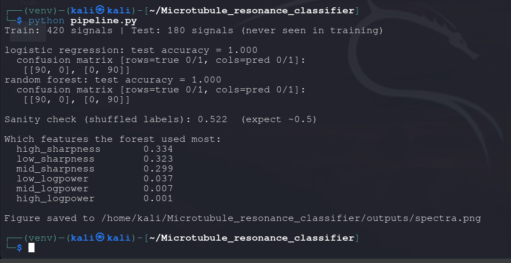

Both models scored 100% on the test set, and the shuffled-label control scored 0.522. The forest relied on peak sharpness (importances 0.334, 0.323, 0.299) and almost ignored band power (0.037, 0.007, 0.001).

A perfect score means the task is too easy, not that the model is impressive. The signal is simply obvious at this noise level, which motivated Step 2.

Example spectra (ordered against decohered, one signal each):

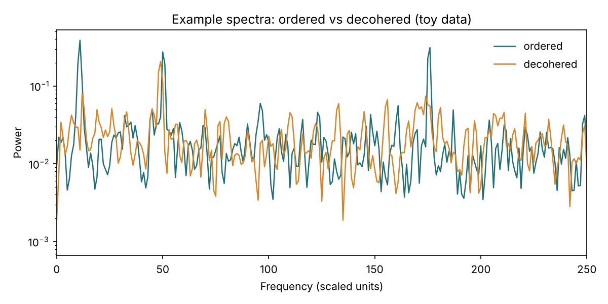

The ordered signal (teal) has three narrow towers. The decohered signal (orange) has the same pitches smeared into wider, lower hills.

### Step 2: accuracy against noise

Script: `sweep.py`, shared settings in `common.py`

To get a curve instead of one number, noise was raised from 1 to 15 across 9 levels. Each point is the mean over 5 seeds with 150 signals per class. Peaks moved to 30, 70 and 100 to suit the three-level system in Step 3.

Mean test accuracy, random forest (mean over 5 seeds):

| Noise | Toy source | QuTiP source |
|---|---|---|
| 1 to 3 | 100% | 100% |
| 4 | 99.8% | 95.3% |
| 6 | 93.1% | 75.3% |
| 8 | 75.1% | 61.8% |
| 10 | 62.7% | 56.0% |
| 12 | 53.6% | 52.2% |
| 15 | 55.1% | 47.3% |

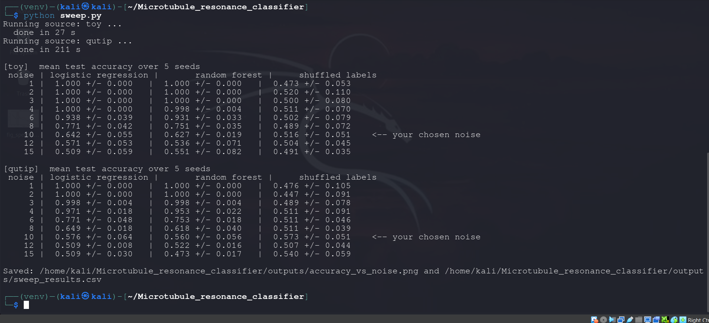

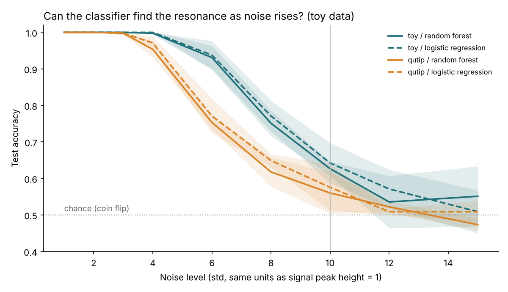

How to read the figure: left is a quiet room, right is a loud room. The line is how often the model is right, the band is the spread across seeds, and the dotted line at 50% is a coin flip.

At noise 10 on the QuTiP source the model scored 56%, while its shuffled-label control scored 57%. At that point the model is not distinguishable from guessing. Past noise 12 both curves wander around 50%, and the wobble is noise rather than signal.

### Step 3: a quantum source with QuTiP

Script: `qutip_sim.py`

Picture a building with three floors (levels 0, 1, 2). A quantum ball can be on all three floors at once, and each pair of floors produces a hum whose pitch depends on the height gap:

- floors 0 and 1 give hum A
- floors 1 and 2 give hum B
- floors 0 and 2 give hum C

That is why there are three peaks, at E1, E2 minus E1, and E2 (here 30, 70, 100). Because C is the sum of A and B, the three pitches cannot be placed independently in this model.

The environment is like a crowd bumping the building. Each bump scrambles the hum a little, so it fades. The fade time is tau.

Model:

- Hamiltonian: levels at energies 0, E1, E2.
- Collapse operators: pure dephasing on each level, with rate gamma = 1/tau.
- Initial state: equal superposition of the three levels with random relative phases.
- Observable: the sum of the coherences between all pairs of levels. It wiggles at the three transition frequencies and the wiggles fade at rate gamma.

The solver is compared against the exact formula before use. For pure dephasing the exact answer is a fading wave, and the script prints OK when the largest difference is below 1e-4.

Signal over time, no noise added:

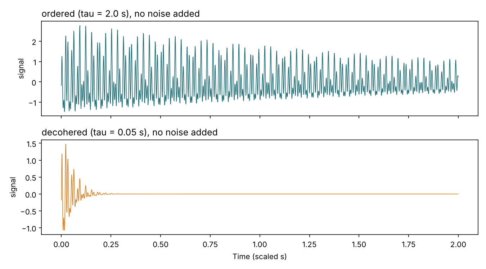

Top (ordered): a busy wiggle that is still going after 2 s. Bottom (decohered): the wiggle dies within about a quarter of a second and the trace goes flat.

The three levels are scaled placeholders. This is not a model of tryptophan or of a microtubule.

### Step 4: the MHz band with literature peaks

Scripts: `mhz_band.py`, `mhz_sweep.py`

Changes from Steps 1 to 3:

- The eight MHz peaks from the literature replace the placeholder peaks.
- A three-level system cannot make eight independent peaks, so the QuTiP source here is eight independent two-level systems, one per peak, each with its own dephasing.
- Decoherence times come from measured sharpness, tau = Q / (pi * f), instead of guesses. Ordered uses Q = 200, the middle of the reported MHz range of 100 to 300.
- Decohered uses Q = 4. This is an assumption: it is the low end seen in the kHz band, not something measured for the MHz band.
- Duration is 4 s so the closely spaced 20 and 22 peaks can be resolved.

Resulting widths and times (1 MHz = 1 scaled Hz):

| MHz | tau ordered (s) | tau decohered (s) | width ordered (Hz) | width decohered (Hz) |
|---|---|---|---|---|
| 12 | 5.305 | 0.1061 | 0.06 | 3.0 |
| 20 | 3.183 | 0.0637 | 0.10 | 5.0 |
| 22 | 2.894 | 0.0579 | 0.11 | 5.5 |
| 30 | 2.122 | 0.0424 | 0.15 | 7.5 |
| 101 | 0.630 | 0.0126 | 0.51 | 25.2 |
| 113 | 0.563 | 0.0113 | 0.56 | 28.2 |
| 185 | 0.344 | 0.0069 | 0.93 | 46.2 |
| 204 | 0.312 | 0.0062 | 1.02 | 51.0 |

With a fixed Q, higher-frequency peaks fade faster.

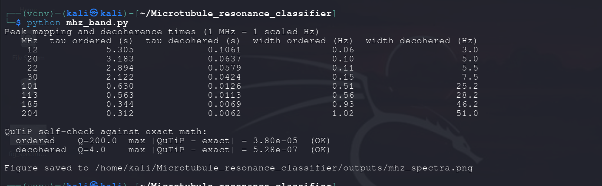

Both QuTiP self-checks pass (largest difference 3.8e-5 for ordered, 5.3e-7 for decohered).

Example noisy spectra, with the literature peaks marked:

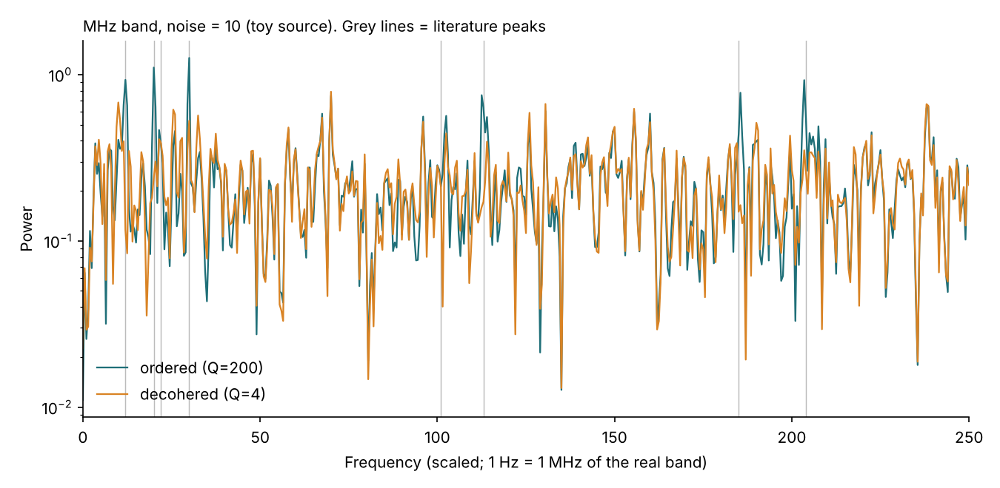

Accuracy against noise (random forest, mean over seeds; toy uses 100 signals per class and 5 seeds, QuTiP uses 40 per class and 3 seeds because it is slow):

| Noise | Toy | QuTiP |
|---|---|---|
| 2 | 100% | 100% |
| 5 | 100% | 100% |
| 8 | 99.0% | 88.9% |
| 10 | 95.7% | 76.4% |
| 12 | 88.3% | 66.7% |
| 15 | 81.7% | 58.3% |
| 20 | 65.3% | 37.5% |
| 30 | 53.0% | 54.2% |

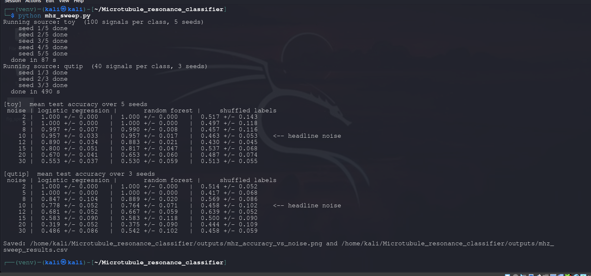

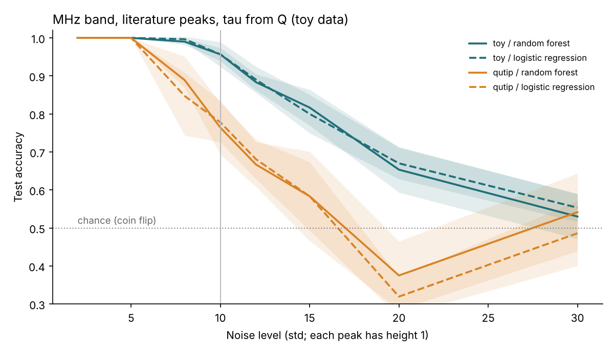

Two points for reading this:

- **The QuTiP curve falls earlier than the toy curve.** The next step shows why, and that it is mostly an artifact of signal energy.
- **The 37.5% at noise 20 is below a coin flip.** With only 24 test signals per run, that is most likely a small-sample artifact. Treat noise 20 and above as chance.

### Step 5: how similar can the classes be, and a fairness check

Script: `mhz_ab.py` (run `python mhz_ab.py A` and `python mhz_ab.py B`), plus `energy_check.py`

#### A. How similar can decohered be to ordered?

Ordered stays at Q = 200. The Q of the decohered class is raised from 4 up to 200. At 200 the two classes are identical by construction, so accuracy must fall to about 50%. It does, which makes this a built-in sanity check. All signals are rescaled to equal energy. Mean of 5 seeds, 100 signals per class.

Random forest accuracy:

| Decohered Q | Ordered is this many times sharper | Toy, noise 5 | Exact, noise 5 | Toy, noise 10 | Exact, noise 10 |
|---|---|---|---|---|---|
| 4 | 50 | 100% | 100% | 96.0% | 100% |
| 10 | 20 | 100% | 100% | 92.0% | 99.7% |
| 25 | 8 | 99.7% | 100% | 88.3% | 99.0% |
| 50 | 4 | 94.3% | 99.7% | 73.3% | 91.3% |
| 100 | 2 | 77.7% | 87.0% | 54.0% | 68.7% |
| 150 | 1.3 | 57.7% | 62.7% | 50.0% | 50.7% |
| 200 | 1 | 52.3% | 53.0% | 51.7% | 48.3% |

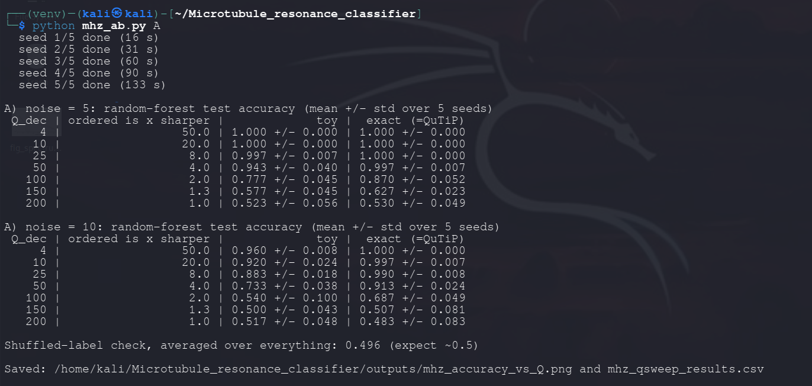

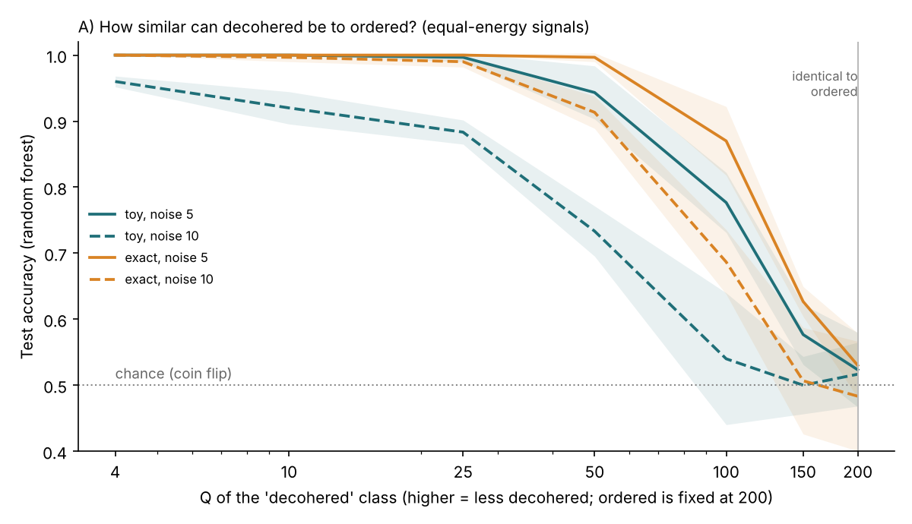

Reading: the model needs the ordered peaks to be roughly 2 to 4 times sharper than the decohered ones to work well. When they are within about 30% of each other it can barely tell them apart. At higher noise the required gap grows.

The "exact" source is the closed-form fading-wave formula. It uses the same random draws as the QuTiP source and matches it to about 4e-5, so it gives the same signals about 1000 times faster.

#### B. Equal-energy fairness check

In the Step 4 results the QuTiP source looked harder than the toy source. `energy_check.py` measures why:

| Class | Toy power | QuTiP power | QuTiP / toy |
|---|---|---|---|
| ordered (Q = 200) | 4.002 | 0.854 | 0.213 |
| decohered (Q = 4) | 3.993 | 0.018 | 0.004 |

A fading signal carries less total energy, and the decohered QuTiP signal carries almost none (0.4% of the toy). In the toy source both classes have equal power, so the model must judge peak sharpness. In QuTiP it could also win by noticing "something there" against "almost nothing", which is a different and, here, easier question.

To make the comparison fair, every clean signal was rescaled to the same total power before noise was added. The only change from the Step 4 run is that rescaling, with the same random draws.

Random forest accuracy:

| Noise | Toy raw | Toy equal energy | QuTiP raw | QuTiP equal energy |
|---|---|---|---|---|
| 2 | 100% | 100% | 100% | 100% |
| 5 | 100% | 100% | 100% | 100% |
| 8 | 99.0% | 99.3% | 88.9% | 100% |
| 10 | 95.7% | 95.3% | 76.4% | 100% |
| 12 | 88.3% | 87.0% | 66.7% | 98.6% |
| 15 | 81.7% | 80.7% | 58.3% | 90.3% |
| 20 | 65.3% | 66.0% | 37.5% | 76.4% |
| 30 | 53.0% | 57.3% | 54.2% | 54.2% |

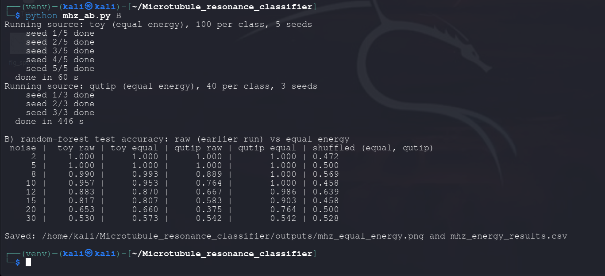

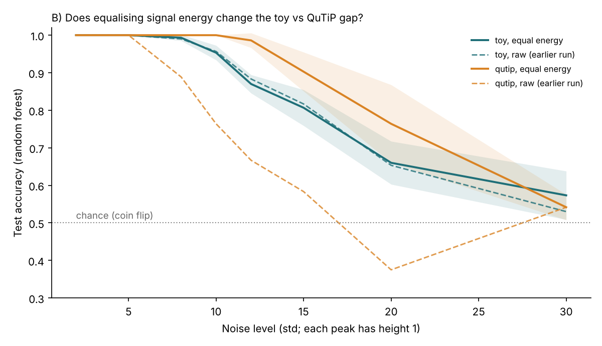

Toy results barely move, as expected. QuTiP jumps from 76% to 100% at noise 10. With equal energy, the QuTiP-style signal is easier than the toy one, the opposite of the earlier impression.

My reading is that a fading signal puts all its energy into a short burst, and a short burst stands out from noise more than the same energy spread over 4 s. I have not tested that explanation directly.

This is a modelling choice, not a neutral correction. Rescaling amplifies the decohered QuTiP burst by about 15 times in amplitude. The toy source models a signal held steady by a drive. The QuTiP source models a free fade after a single kick. These are different experiments and neither is "the real one".

---

## Limitations

1. **The labels are planted.** There is no real-world label for a "conscious" or "ordered quantum" state. "Ordered" and "decohered" are defined here by me as sharp against smeared peaks. The classifier learns the difference I built in. It cannot confirm or refute any theory.
2. **Only one thing differs between classes.** Peak sharpness. Peak positions and (in the toy source) total power are identical, so this is a deliberately narrow task.
3. **The quantum model is simple.** Independent two-level systems (and one three-level system) with pure dephasing have a closed-form answer, and QuTiP reproduces it. The simulation is a verified foundation, not new physics.
4. **Q for the decohered class is an assumption.** Q = 4 is borrowed from the kHz band and applied to the MHz band.
5. **Quantum decoherence time and classical resonance width are treated as the same thing.** The measured resonances are classical electrical signals. Equating them with quantum coherence is a hypothesis, not an established result.
6. **Frequencies are scaled.** 1 MHz is simulated as 1 Hz. Results are not comparable across bands and say nothing about real kHz, MHz or GHz hardware.
7. **Literature numbers are approximate.** MHz peak positions come from a figure axis and were not checked against raw data. The source papers contain inconsistencies, report blinking peaks, and I found no independent replication. Orch-Or itself is not an accepted theory.
8. **Small samples in the QuTiP runs.** 40 signals per class and 3 seeds, because the solver takes about 1 second per signal. Test sets have only about 24 signals, so single cells wobble by several points. Shuffled-label controls reached 0.64 in one cell for this reason.
9. **Noise levels are not independent.** Within one seed, the same clean signals are reused across noise levels with fresh noise each time. The curves are smooth partly for that reason.
10. **Hand-made features and simple classifiers.** Only band power and peak sharpness are used, with logistic regression and a random forest. No neural network has been tried.

---

## Reproduce it

Tested with Python 3.14 on Linux (Kali) in a virtual environment, QuTiP 5.3.1.

```
git clone https://github.com/MrWater00/Microtubule_resonance_classifier.git
cd Microtubule_resonance_classifier
python -m venv venv
source venv/bin/activate
pip install -r requirements.txt
```

Run, in this order (times from my machine):

```
python pipeline.py            # Step 1, a few seconds
python qutip_sim.py           # Step 3 self-check, a few seconds
python sweep.py               # Step 2 plus QuTiP source, about 4 min
python mhz_band.py            # Step 4 self-check and spectrum, about 10 s
python mhz_sweep.py           # Step 4 sweep, about 10 min
python mhz_ab.py A            # Step 5A, about 2 min
python mhz_ab.py B            # Step 5B, about 8 min
python energy_check.py        # energy measurement, about 30 s
```

Outputs (figures, CSV result tables, logs) are written to `outputs/`. Seeds are fixed, so a rerun should reproduce the tables above.

If you see `ModuleNotFoundError`, check that the virtual environment is active (the prompt should start with `(venv)`) and that `common.py` is spelled in lowercase.

---

## Repository layout

```
pipeline.py          Step 1: full toy pipeline, self-contained
common.py            Shared settings and helpers for Steps 2 and 3
qutip_sim.py         Step 3: three-level QuTiP source, with exact-math check
sweep.py             Step 2: accuracy against noise, toy and QuTiP sources
mhz_band.py          Step 4: MHz-band signals (toy, QuTiP, exact), tau from Q
mhz_sweep.py         Step 4: accuracy against noise for the MHz band
mhz_ab.py            Step 5: experiments A (decohered Q) and B (equal energy)
energy_check.py      Signal power of each source, behind experiment B
docs/                Literature notes and terminal screenshots
outputs/             Figures, CSV result tables, run logs
requirements.txt
```

---

## How this was built

This is a learning project about working with AI coding agents. The split of roles:

- **The AI wrote the scripts** and proposed options at each step.
- **I acted as the architect.** I chose the build order, the noise level, the number of classes, which experiments to run, and how to handle real frequencies and decoherence times.
- **Verification was part of the workflow, not an afterthought.** QuTiP is checked against exact math, every result has a shuffled-label control, results are averaged over seeds, and a suspicious result (QuTiP looking harder than the toy source) was investigated and traced to signal energy rather than accepted.
- **The AI's early explanation was wrong, and was corrected.** It first guessed that random starting phases explained the QuTiP gap. Looking at the traces suggested energy, and Step 5B tested that and reversed the conclusion.

---

## Possible next steps

- Run the kHz and GHz bands, each in its own scaled window.
- Replace the hand-made features with a small 1D convolutional network (PyTorch) on the raw signals, and compare.
- Use QuTiP for models without a closed form: noise with memory, coupled systems, more levels.
- Check the peak positions against the original data, and test how robust the results are to peak-position errors.
- Add a third class (partly decohered) and see how the confusion matrix changes.

---

## Sources

- Bandyopadhyay group, single-microtubule electromagnetic resonance, Fractal and Fractional (2020): https://www.mdpi.com/2504-3110/4/2/11/htm
- Bandyopadhyay group, atomic water channel paper (postprint): https://research.iitj.ac.in/pdf/postprint-atomic-water-channel-controlling-remarkable-properties
- Quantum effects in the brain: a review (decoherence-time estimates by Tegmark and by Hagan et al.): https://arxiv.org/pdf/1910.08423
- QuTiP, the Quantum Toolbox in Python: https://qutip.org
